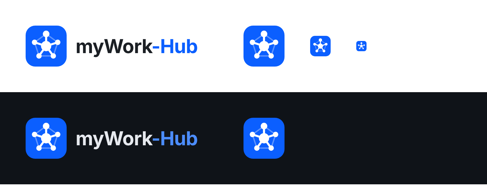

# Logo myWork-Hub

| Bestand | Gebruik |
| --- | --- |
| `logo.svg` | Logo met woordmerk, lichte achtergrond |
| `logo-dark.svg` | Logo met woordmerk, donkere achtergrond |
| `logo-mark.svg` | Beeldmerk (app-icoon, favicon) |

Beeldmerk: een centraal knooppunt (de core) met vijf verbonden knooppunten (de apps).
Kleur `#0b5fff`, woordmerk in Inter vet. Het woordmerk gebruikt tekst; voor drukwerk of
plaatsen zonder Inter het woordmerk eerst naar paden omzetten.
